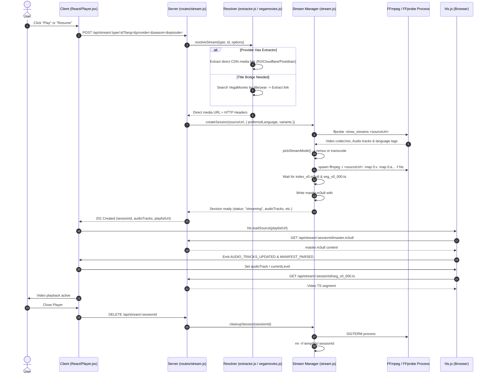

# STREAMIX 2.0 — Desktop Migration Audit (Baseline Assessment)

**Date:** 2026-10-19  
**Target:** Monorepo at `d:/saif/streamix` (Restored Working Backup)  
**Auditor:** Antigravity AI Assistant  
**Document Status:** Complete Baseline Audit (Phase 1)

---

## 1. Executive Summary & Baseline Status

STREAMIX was conceived as a responsive, Netflix-style streaming web application consuming real metadata and streams from CloudStream/CSX provider ports (primarily **CineStream** for Stremio/Cinemeta catalogs and **VegaMovies** for Hindi/English movie & series stream resolution).

In its current restored web architecture:
- **Frontend:** Single-page React 19 application built with Vite 8, styled with modern Vanilla CSS, using `hls.js` (v1.7.3) for browser video playback.
- **Backend:** Node.js Express 5 server acting as an API gateway, provider scraper/normalizer, and media processing engine.
- **Playback Engine:** Server-side FFmpeg 9.0.2 demuxes MKV/MP4 sources, extracts multiple audio streams via `ffprobe`, remuxes (or transcodes when necessary) into an HLS stream with `#EXT-X-MEDIA` audio groups, and serves `.m3u8` playlists and `.ts` segments to the browser.
- **Verification Reality:**
  - Automated test suite (`npm run test`) runs **131 tests (97 server, 34 client)**. All 131 pass. These tests cover unit logic, mock-based extraction, and an FFmpeg remux test against a **local synthetic MKV fixture**.
  - **No automated browser playback test** exists in `npm test`. In-browser playback verifications recorded in `PROGRESS.md` were performed interactively or via ad-hoc Puppeteer scripts during development.
  - **Live Real-Provider Playback Status (Observed Live):** While the pipeline logic is fully implemented, live stream resolution against VegaMovies currently fails (`404 Not Found` returned by `https://1vegamovies.baby/search.php?q=...` due to upstream domain shifting). When `fixture=1` is supplied, server-side FFmpeg HLS conversion and playback session creation function.

---

## 2. Current Architecture & Entry Points

### 2.1 Repository Structure
The repository is an npm workspace monorepo consisting of:
- `package.json`: Root package defining workspaces `["packages/*"]`, global devDependencies (`concurrently`), and top-level scripts.
- `packages/client/`: React 19 + Vite 8 frontend.
- `packages/server/`: Node.js + Express 5 backend.
- `scripts/`: Operational and verification scripts (`healthcheck.mjs`, `make-test-fixture.mjs`, `spike-hls.mjs`, `make-fixture.mjs`).
- `temp/`: Local directory for synthetic test fixtures (`temp/fixtures/multi-audio.mkv`) and temporary HLS session workspaces (`temp/hls/<sessionId>/`).

### 2.2 Frontend Framework & Entry Points
- **Framework:** React 19.3.0, bundled with Vite 8.3.4 (`@vitejs/plugin-react` 6.1.2).
- **HTML Entry:** [`packages/client/index.html`](file:///d:/saif/streamix/packages/client/index.html).
- **JS Entry:** [`packages/client/src/main.jsx`](file:///d:/saif/streamix/packages/client/src/main.jsx) (mounts `<App />` to `#root`).
- **Root Component:** [`packages/client/src/App.jsx`](file:///d:/saif/streamix/packages/client/src/App.jsx) (manages application view: `home`, `movies`, `series`, `search`, active modal, active player, and continue-watching persistence).
- **Global Styles:** [`packages/client/src/index.css`](file:///d:/saif/streamix/packages/client/src/index.css) (1,749 lines of custom dark-mode CSS; no Tailwind).
- **API Client:** [`packages/client/src/api.js`](file:///d:/saif/streamix/packages/client/src/api.js) (wraps `fetch` calls to backend `/api/*` endpoints).
- **Dev Server Proxy:** [`packages/client/vite.config.js`](file:///d:/saif/streamix/packages/client/vite.config.js) proxies `/api` requests to `http://localhost:4000`.

### 2.3 Backend Architecture & Entry Points
- **Framework:** Express 5.3.0 on Node.js (ESM modules throughout, `type: module`).
- **Server Entry:** [`packages/server/src/index.js`](file:///d:/saif/streamix/packages/server/src/index.js) (configures Express, in-memory caches, provider registry, stream manager, registers routes, checks/cleans HLS temporary directory on boot, and starts listening on `PORT` 4000).
- **Configuration:** [`packages/server/src/config.js`](file:///d:/saif/streamix/packages/server/src/config.js) (loads `.env` via `process.loadEnvFile`, establishes port, TMDB key, FFmpeg/FFprobe binaries, fixture settings, and session reaper timing).
- **Cache Module:** [`packages/server/src/cache.js`](file:///d:/saif/streamix/packages/server/src/cache.js) (`TtlCache` with bounded size, LRU pruning, and TTL expiration).
- **Logging & Error Standard:** [`packages/server/src/logger.js`](file:///d:/saif/streamix/packages/server/src/logger.js) (structured JSON logger) and [`packages/server/src/errors.js`](file:///d:/saif/streamix/packages/server/src/errors.js) (`ProviderError` mapped to HTTP 400, 404, 422, 502, 504).

---

## 3. Provider Implementations & Resolution Flow

### 3.1 Registered Providers
Located in [`packages/server/src/providers/index.js`](file:///d:/saif/streamix/packages/server/src/providers/index.js):
1. **`CineStream` ([`packages/server/src/providers/cinemeta.js`](file:///d:/saif/streamix/packages/server/src/providers/cinemeta.js)):**
   - **Source:** Port of CloudStream's CineStream extension.
   - **Capabilities:** Catalog discovery, search, and detail metadata.
   - **Endpoints:**
     - Catalogs: `https://cinemeta-catalogs.strem.io/top/catalog/{type}/top/skip={skip}[&genre={genre}].json`
     - Anime Catalogs: `https://anime-kitsu.strem.fun/catalog/anime/{catalogId}/skip={skip}.json`
     - Search: `https://v3-cinemeta.strem.io/catalog/{type}/top/search={query}.json` + Kitsu airing anime search
     - Details: `https://v3-cinemeta.strem.io/meta/{type}/{id}.json`
   - **Stream Extraction:** Not natively supported (`supportsStreamResolution: false`).
2. **`VegaMovies` ([`packages/server/src/providers/vegamovies.js`](file:///d:/saif/streamix/packages/server/src/providers/vegamovies.js)):**
   - **Source:** Port of CloudStream's VegaMovies scraper.
   - **Capabilities:** Search (via JSON search endpoint), detail parsing, and multi-tier stream resolution (`supportsStreamResolution: true`).
   - **Resolution Mechanics:**
     - Reads base URL dynamically from `https://raw.githubusercontent.com/SaurabhKaperwan/Utils/refs/heads/main/urls.json` (key `vegamovies`) with fallback `https://vegamovies.gallery`.
     - Queries search API: `GET {base}/search.php?q={query}&page=1`.
     - Parses post pages, discovers download buttons (`dwd-button`) and quality sections (`⚡ G-Direct`, `⚡ V-Cloud`, `⚡ Single Episodes`).
     - Extracts intermediate host URLs (`vcloud`, `nexdrive`, `hubcloud`, `pixeldrain`).
     - Decodes nested double-Base64 tokens (`atob(atob(...))`).
     - Probes candidates with `ffprobe` (passing source `Referer`) to validate playable video.
     - Sorts renditions into a quality ladder (e.g. 1080p, 720p, 480p).
3. **Optional TMDB Enrichment ([`packages/server/src/providers/tmdb.js`](file:///d:/saif/streamix/packages/server/src/providers/tmdb.js)):**
   - Enhances posters/backdrops/ratings using a user-provided `TMDB_API_KEY`.
   - Never blocks page loads (runs asynchronously to warm `tmdbCache`).

### 3.2 Provider Search & Title-Bridge Resolution Flow
When the client searches or requests playback:
1. **Search ([`packages/server/src/routes/search.js`](file:///d:/saif/streamix/packages/server/src/routes/search.js)):**
   - Executes parallel searches across all search-capable providers (`CineStream` and `VegaMovies`).
   - Merges and deduplicates results by normalized title and year.
   - Ranks results using `relevanceScore` (exact match > prefix > word boundary > token match).
2. **Title-Bridge Resolver ([`packages/server/src/providers/extractor.js`](file:///d:/saif/streamix/packages/server/src/providers/extractor.js)):**
   - If a title comes from `CineStream` (which has IMDb IDs like `tt1877830` and no video extractor), the resolver initiates a **Title Bridge**.
   - `VegaMoviesProvider.resolveByTitle({ title, year, type, season, episode })` searches VegaMovies for the title and year, scores candidates (`scoreTitleMatch`), and passes the best match to VegaMovies' link extractor.
   - If no real stream resolves and `allowFixture` is true (`fixture=1`), it falls back to `temp/fixtures/multi-audio.mkv`. Otherwise, it returns HTTP 422 with an explicit failure reason.

---

## 4. End-to-End Playback Flow & Code Trace



### Detailed Trace by Step

| Step | Operation | Key File(s) | Primary Function(s) |
|---|---|---|---|
| **1** | **Search** | `packages/client/src/components/SearchBox.jsx`<br>`packages/server/src/routes/search.js` | `handleSearch()`<br>`rankSearchResults()`, `mergeSearchResults()` |
| **2** | **Title Selection** | `packages/client/src/App.jsx`<br>`packages/client/src/components/DetailModal.jsx`<br>`packages/server/src/routes/detail.js` | `openDetail(item)`<br>`adapter.getDetails(type, id)` |
| **3** | **Stream Resolution** | `packages/server/src/providers/extractor.js`<br>`packages/server/src/providers/vegamovies.js` | `doResolve()`, `resolveStream()`<br>`resolveByTitle()`, `extractLinkPages()`, `mediaCandidatesFromHtml()` |
| **4** | **Playback Init** | `packages/client/src/api.js`<br>`packages/server/src/routes/stream.js`<br>`packages/server/src/providers/stream.js` | `createStream()`<br>`router.post("/stream/:type/:id")`<br>`createStreamManager.createSession()` |
| **5** | **Audio & Quality Handling** | `packages/server/src/providers/stream.js`<br>`packages/client/src/components/Player.jsx`<br>`packages/client/src/lib/quality.js` | `buildAudioLayout()`, `buildMasterPlaylist()`<br>`syncAudio()`, `syncLevels()`<br>`applyQuality()`, `audioTrackLabel()` |
| **6** | **Session Teardown** | `packages/client/src/components/Player.jsx`<br>`packages/server/src/providers/stream.js` | `cleanupStream(sessionId)` on unmount<br>`cleanupSession()`, `cleanupExpiredSessions()` |

---

## 5. Backend Dependencies & Frontend Coupling Analysis

The frontend **cannot operate independently** in a browser environment without the backend for the following fundamental reasons:

1. **Scraping & CORS Restrictions:**
   Third-party providers (`cinemeta.strem.io`, `kitsu.strem.fun`, `vegamovies`) do not send permissive CORS headers for arbitrary browser web origins. Direct requests from a browser client are blocked by CORS.
2. **Strict Request Headers:**
   Video hosts (`vcloud.beer`, `hubcloud`, Cloudflare R2 storage) strictly validate `Referer`, `Origin`, and `User-Agent`. Browser JavaScript cannot arbitrarily override `Referer` or `User-Agent` due to browser security sandboxing (`Refused to set unsafe header`).
3. **Format & Container Limitations:**
   Provider links frequently resolve to `.mkv` containers with multiple audio streams (e.g. Hindi, English 5.1). Web browsers have no native support for demuxing `.mkv` containers or switching multi-track audio tracks without transcoding/remuxing.
4. **FFmpeg & Transcoding:**
   The entire HLS conversion (`spawn(ffmpegPath, ...)`), stream probing (`ffprobe`), and segment generation execute as Node.js child processes on local disk.
5. **Session Management & Concurrency:**
   Session deduplication, concurrency bounding (`maxConcurrent: 2`), and automatic reaper sweep (`reaperIntervalMs`) are managed by Node.js.

---

## 6. Player UI Components & Styling to Preserve

The existing web player in [`packages/client/src/components/Player.jsx`](file:///d:/saif/streamix/packages/client/src/components/Player.jsx) and [`packages/client/src/index.css`](file:///d:/saif/streamix/packages/client/src/index.css) provides a polished, Netflix-style experience that must be preserved when migrating to a desktop engine:

### 6.1 Functional Player Controls to Preserve
- **Cinematic Stage:** Pure black backdrop, video styled with `object-fit: contain`, subtle top and bottom gradient vignettes.
- **Top Bar:**
  - Round pill "‹ Back" button returning to detail modal or catalog.
  - Truncated title with full tooltip (supporting series formatted as `Title — S1E2 · Episode Name`).
  - Source Badges: Green badge `Real source · VegaMovies` vs Yellow badge `TEST MODE`.
  - Source note display showing resolved tier and quality info.
- **Center Overlay:**
  - Radial gradient centered loader with spinning red ring (`.player-spinner`) and informative text ("Resolving stream and preparing HLS...").
  - Centered Big Play button (`▶`) when paused.
  - Compact centered error panel with red header, scrollable error description, and action buttons ("Retry" and "Back").
  - Toast banner notifying resume position ("Resumed from 2:00") or playback completion ("Finished").
  - "Play Next" prompt for TV series when an episode finishes.
- **Bottom Control Bar:**
  - Dual-gradient scrubber / timeline: Custom styled `<input type="range">` showing played fill (red `#e50914`), buffered fill (translucent white), and track background.
  - Tabular elapsed time and total duration (`0:00 / 0:00`).
  - Play/Pause toggle (`❚❚` / `▶`).
  - Quick skip buttons: Jump backward 10s (`⟲ 10`) and forward 10s (`10 ⟳`).
  - Volume slider with custom slider track and mute toggle (`🔊` / `🔇`).
  - Multi-Audio Track Selector: Populated with ISO 639 language names (`languages.js`) rather than raw codes.
  - Video Quality Selector: Shows real resolutions (e.g., `1080p`, `720p`, `Auto`) or a static indicator if only single quality exists.
  - Playback Speed Selector (`0.5×`, `0.75×`, `1×`, `1.25×`, `1.5×`, `2×`).
  - Series "Next ⏭" button to transition to the next episode.
  - Fullscreen toggle button (`⤢ Full` / `⤢ Exit`).

### 6.2 Micro-Interactions & Styling
- **Autohide Behavior:** Controls fade out (`opacity: 0`, `pointer-events: none`) after 3 seconds of mouse/touch inactivity during playback; cursor turns to `none`. Controls reappear on any mouse move.
- **Keyboard Shortcuts:**
  - `Space` / `K`: Play / Pause.
  - `ArrowLeft` / `ArrowRight`: -10s / +10s seek.
  - `M`: Mute / Unmute toggle.
  - `F`: Fullscreen toggle.
  - `Escape`: Close player and exit back to modal.

---

## 7. Build, Test, and Playback Verification Audit

### 7.1 Distinction Among Test Types in Codebase

| Test Classification | How It Runs | What It Actually Verifies | What It Does NOT Verify |
|---|---|---|---|
| **Build Check** | `npm run build` | Vite bundling, JSX syntax, CSS minification, chunking. | Does not test server APIs, providers, or video playback. |
| **Client Library Tests** | `npm run test:client` | Pure logic tests for `carousel.js`, `languages.js`, `progress.js`, `quality.js`. | Does not test React rendering or DOM/media elements. |
| **Server Unit Tests** | `packages/server/*.test.js` | Caching, string normalizers, match score algorithms, query validators, URL redaction. | Does not make live network calls. |
| **Mocked Provider Tests** | `cinemeta.test.js`<br>`vegamovies.test.js`<br>`extractor.test.js` | Provider error handling, candidate ranking, retry loops, fallback cascades. | Does not hit real live provider domains. |
| **Local Fixture Playback Test** | `stream.test.js` | FFmpeg/ffprobe execution on `temp/fixtures/multi-audio.mkv`, audio extraction, master playlist generation. | Does not verify browser playback, audio decoding, or real provider streams. |
| **Live Browser Playback** | *(No automated script in repo)* | End-to-end user experience in Chrome/Edge (MSE/hls.js buffer, decoders, audio output). | Verified historically during development sessions; not in CI or `npm test`. |

### 7.2 Verification Execution Evidence

1. **Automated Test Suite:**
   - **Command:** `npm run test`
   - **Result:** **131 tests passed** (97 server unit/integration tests, 34 client unit tests; 0 failures).
2. **Client Build:**
   - **Command:** `npm run build`
   - **Result:** Successfully built in 256ms via Vite 8.3.4 (outputting `dist/index.html`, `dist/assets/index-*.js`, `dist/assets/index-*.css`, and lazy-loaded `dist/assets/hls-*.js`).
3. **Healthcheck:**
   - **Command:** `node scripts/healthcheck.mjs` against server on port 4000
   - **Result:** `HEALTH OK http://localhost:4000/api/health -> {"ok":true,"name":"streamix-server","version":"0.3.0",...}`.
4. **Live Provider Probing (Current State):**
   - **CineStream:** `GET /api/home/trending` returned 24 real movie items from Cinemeta within 200ms. `GET /api/search?q=batman` returned 34 Cinemeta results.
   - **VegaMovies:** `GET /api/search?q=batman` reported `count: 0, error: "http"`. Direct inspection revealed `https://raw.githubusercontent.com/SaurabhKaperwan/Utils/refs/heads/main/urls.json` currently points to `https://1vegamovies.baby`, which returns HTTP 404 for `/search.php`.
   - **Live Stream Resolution:** `POST /api/stream/movie/tt1877830?provider=CineStream` failed honestly with HTTP 422: `"No real stream source is available for this title (no supported extractor in: CineStream; title-based lookup failed: upstream responded 404 for https://1vegamovies.baby/search.php?q=The%20Batman&page=1)."`.
   - **Fixture Stream Resolution:** `POST /api/stream/movie/tt1877830?provider=CineStream&fixture=1` succeeded with HTTP 201 (`streamMode: "remux"`, 2 audio tracks: `en` / `es`, HLS master playlist generated and served with status `streaming`).

---

## 8. Known Issues, Uncertainties & Anomalies

1. **Upstream VegaMovies Domain 404:**
   The external URL dictionary (`urls.json`) points VegaMovies to `https://1vegamovies.baby`, which has decommissioned or relocated `/search.php`. Real-provider stream resolution will fail until an active base domain is configured or updated.
2. **Root Directory Artifact Folders:**
   The repository root contains 27 extraneous directories with names matching FFmpeg CLI arguments (`-ac`, `-crf`, `-f`, `-hide_banner`, `-hls_flags`, `-hls_playlist_type`, `-hls_segment_filename`, `-hls_time`, `-i`, `-loglevel`, `-map`, `-nostdin`, `-p`, `-pix_fmt`, `-preset`, `-y`, `128k`, `2`, `23`, `4`, `aac`, `error`, `ffmpeg`, `hls`, `independent_segments`, `libx264`, `veryfast`, `vod`, `webvtt`, `yuv420p`). These were accidentally generated by a legacy script running `mkdir` or `ffmpeg` with unquoted variables.
3. **Absence of Git Repository:**
   The restored backup is an unpacked folder with no `.git` metadata initialized.
4. **Temporary Session Disk Footprint:**
   The web server's FFmpeg HLS pipeline generates `.ts` video slices in `temp/hls/<sessionId>/`. A periodic reaper sweeps expired directories, and a startup sweep cleans orphans; however, heavy playback transcode sessions consume temporary disk storage.

---

## 9. Recommended Desktop Migration Order (Electron + React + libmpv)

Migrating STREAMIX from a browser HLS model to a native desktop application with Electron and `libmpv` is the ideal architectural evolution. It eliminates the need for server-side FFmpeg transcoding and HLS slicing while retaining the existing UI and provider scrapers.

### Architecture Comparison
```
[CURRENT WEB PIPELINE]
Provider Direct Stream (.mkv)
  └─► Server Express (Node.js)
        └─► ffprobe (stream analysis)
        └─► FFmpeg (remux/transcode to HLS .ts chunks on disk)
        └─► HTTP Server serves master.m3u8 & .ts
              └─► Browser Client (hls.js in <video>)

[MIGRATED DESKTOP PIPELINE]
Provider Direct Stream (.mkv) + Headers
  └─► Electron Main Process / Embedded Node
        └─► libmpv Native Player (hardware-accelerated, native MKV, native multi-audio)
              ▲
              │ IPC (play, pause, seek, audio-track, volume, stats)
              ▼
        Electron Renderer (React UI + Custom Player Controls)
```

### Proposed Migration Roadmap

1. **Phase 2A — Scraper & Business Logic Consolidation:**
   - Package provider scrapers (`CineStream`, `VegaMovies`, `TMDB enricher`, and future extractors) into a shared module.
   - Fix upstream VegaMovies domain discovery or fallback mapping.
2. **Phase 2B — Electron Foundation:**
   - Initialize Electron main process and preload script with context isolation.
   - Run provider resolution directly in Electron's Node runtime (or an internal background worker), eliminating CORS and localhost HTTP proxy overhead.
   - Pass custom request headers (`Referer`, `User-Agent`) directly into native requests and media loaders.
3. **Phase 2C — Native libmpv Integration:**
   - Integrate `libmpv` (via Node FFI or native addon such as `node-mpv` / custom bindings).
   - Route direct provider video URLs (even `.mkv`, `.ts`, HEVC, AC3, DTS) straight to `libmpv`.
   - Remove FFmpeg disk remuxing, segment writing, and temporary disk wear.
4. **Phase 2D — Connect Existing React Player UI to libmpv IPC:**
   - Bind [`Player.jsx`](file:///d:/saif/streamix/packages/client/src/components/Player.jsx) controls (seek bar, volume, play/pause, speed, audio selector, quality selector) to `libmpv` IPC events:
     - `mpv.getProperty("track-list")` -> populates `audioTracks`.
     - `mpv.setProperty("aid", trackId)` -> instant native audio track switching without rebuffering.
     - `mpv.observeProperty("time-pos")` -> drives scrubber and `progressStore`.
5. **Phase 2E — Cleanup & Packaging:**
   - Clean legacy shell-argument directories in root.
   - Build native Windows executable (`electron-builder`).

---

## 10. Audit Inspection Log

### Files Inspected
- `package.json` (root)
- `packages/client/package.json`
- `packages/server/package.json`
- `packages/client/vite.config.js`
- `packages/client/index.html`
- `packages/client/src/main.jsx`
- `packages/client/src/App.jsx`
- `packages/client/src/api.js`
- `packages/client/src/index.css`
- `packages/client/src/components/Navbar.jsx`
- `packages/client/src/components/Hero.jsx`
- `packages/client/src/components/Row.jsx`
- `packages/client/src/components/Grid.jsx`
- `packages/client/src/components/TitleCard.jsx`
- `packages/client/src/components/SearchBox.jsx`
- `packages/client/src/components/ContinueWatching.jsx`
- `packages/client/src/components/DetailModal.jsx`
- `packages/client/src/components/Player.jsx`
- `packages/client/src/lib/carousel.js`
- `packages/client/src/lib/languages.js`
- `packages/client/src/lib/progress.js`
- `packages/client/src/lib/quality.js`
- `packages/server/src/index.js`
- `packages/server/src/config.js`
- `packages/server/src/logger.js`
- `packages/server/src/errors.js`
- `packages/server/src/cache.js`
- `packages/server/src/providers/index.js`
- `packages/server/src/providers/base.js`
- `packages/server/src/providers/cinemeta.js`
- `packages/server/src/providers/vegamovies.js`
- `packages/server/src/providers/tmdb.js`
- `packages/server/src/providers/extractor.js`
- `packages/server/src/providers/stream.js`
- `packages/server/src/routes/home.js`
- `packages/server/src/routes/search.js`
- `packages/server/src/routes/detail.js`
- `packages/server/src/routes/stream.js`
- `packages/server/src/routes/providers.js`
- `packages/server/src/providers/stream.test.js`
- `packages/server/src/providers/vegamovies.test.js`
- `scripts/healthcheck.mjs`
- `scripts/make-test-fixture.mjs`
- `scripts/spike-hls.mjs`
- `AGENTS.md`
- `PROGRESS.md`
- `memory.md`
- `rule.md`
- `.env.example`
- `.env`

### Commands Executed & Observed Results
1. `npm run test` -> Passed 131/131 tests (97 server tests, 34 client tests, 0 failures).
2. `npm run build` -> Passed (Vite 8.3.4 compiled client bundle in 256ms).
3. `ffmpeg -version` -> Verified FFmpeg version `9.0.2-full_build-www.gyan.dev` installed and operational.
4. `ffprobe -version` -> Verified ffprobe version `9.0.2-full_build-www.gyan.dev` installed and operational.
5. `npm run start` (temporary background run) -> Express 5 server booted on port 4000, initialized HLS workspace.
6. `node scripts/healthcheck.mjs` -> Passed (`HEALTH OK http://localhost:4000/api/health`).
7. `GET /api/providers/status` -> Verified response structure; `VegaMovies` configured with `verifiedRealPlayback: true`.
8. `GET /api/home/trending` -> Verified 24 items returned from Cinemeta catalog with TMDB enrichment background warming.
9. `GET /api/search?q=batman` -> Verified CineStream returned 34 items; VegaMovies failed with HTTP error.
10. `curl.exe -I -s "https://1vegamovies.baby/search.php?q=batman"` -> Observed HTTP 404 from active VegaMovies base domain.
11. `POST /api/stream/movie/tt1877830?provider=CineStream` -> Observed honest HTTP 422 error detailing upstream VegaMovies 404.
12. `POST /api/stream/movie/tt1877830?provider=CineStream&fixture=1` -> Verified synthetic multi-audio fixture resolution, FFmpeg remuxing, master playlist generation, and session creation.
13. `GET /api/stream/:sessionId/master.m3u8` -> Verified master playlist serving with `#EXT-X-MEDIA` audio tracks.
14. `DELETE /api/stream/:sessionId` -> Verified session cleanup and directory removal.
15. Terminated test server process PID 6320.
